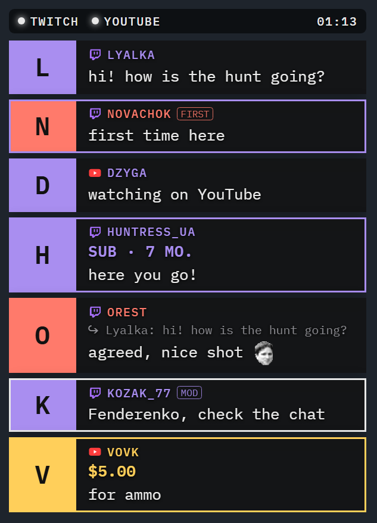
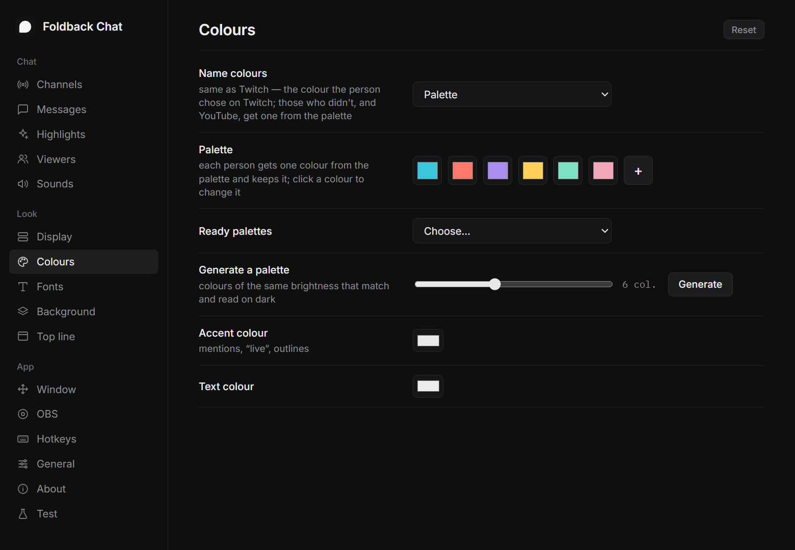
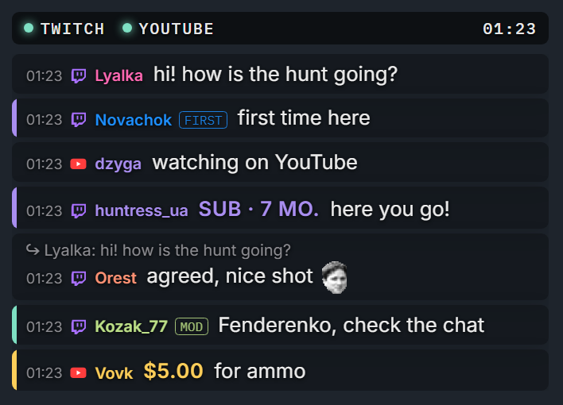
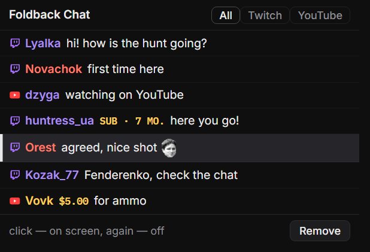
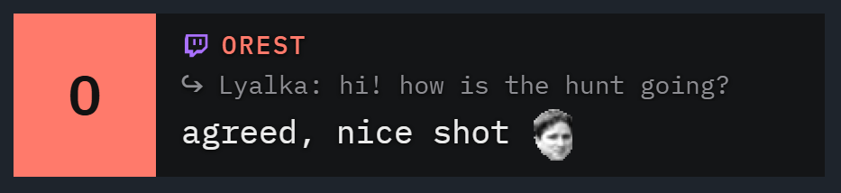

# Foldback Chat

[Українська](README.uk.md) · **English**

Twitch and YouTube chat in one transparent overlay for Windows — either platform on its own or both in one list.
Keep it **over your game**, where only you see it, put it **in OBS** for your viewers, or both at once.

<p align="center">
  
  
</p>
<p align="center">
  
  
</p>

## Features

- **Twitch, YouTube or both.** Twitch as a guest, no password; YouTube without keys, the live stream is found by itself.
  The top line shows each channel's state, down to "channel not found".
- **Over your game, for your eyes only.** A transparent window on top that OBS never captures. Locked, it lets clicks
  through to the game; unlocked, drag it, resize it by the edges and scroll back with the mouse wheel. A separate place
  for every fullscreen game, a choice of monitor, and "With OBS" mode: the chat shows while OBS runs.
- **In OBS, for your viewers.** The same chat as a Browser source, a dock with the whole history right in the OBS
  window, and one click to put any message on stream as a large card.
- **Emotes.** Twitch, 7TV, BTTV and FFZ, YouTube emoji.
- **Nothing important slips by.** Mentions and your own words, first-timers, moderators, subs, raids, bits, Super Chats,
  channel points — as a ring, a glow, a side bar or a tint. Replies show who and what they answer; regulars get their own
  colour and mark.
- **Sounds.** One per kind of event, built-in or your own file, with volume and a pause between sounds. Only you hear
  them: they never get into the stream.
- **Your look.** Cards or compact lines, any font installed in Windows, text size, transparency, colours, name palettes
  (ready-made, your own or generated with even brightness), how many messages and when they fade. The whole chat can
  hide when it's quiet and come back with a new message.
- **Filters.** Bots, commands, links, ignored people.
- **For other apps.** Every message and event as JSON over WebSocket or SSE — for Streamer.bot, Stream Deck or your own
  scripts.
- **9 languages** (English, Українська, Deutsch, Français, Español, Português, Polski, Italiano, Türkçe), settings in a
  file, one small exe without an installer.

## Download

[Releases](https://github.com/Fenderenko/FoldbackChat/releases/latest): `FoldbackChat-<version>.zip` (the app, license,
this file) or the bare `FoldbackChat-<version>.exe`. No installer: run the exe. Windows 10 / 11 with Microsoft Edge
WebView2 Runtime (already part of Windows 11).

## Start

Run `FoldbackChat.exe` — an icon appears in the tray. Click it to show / hide the chat, right-click for the menu.
On the first start the settings open on the channels page. The tray tooltip shows whether each channel is connected.

For the chat over the game, the game has to run in a borderless window, not in exclusive fullscreen.

## Hotkeys (change them in the settings)

- **Alt+Shift+C** — show / hide the chat
- **Alt+Shift+X** — lock / unlock
- **Alt+Shift+S** — open / close the settings

## In OBS

All addresses are in the settings, page OBS, each with a copy button. The app has to be running.

- **The chat.** Sources → + → Browser, `http://127.0.0.1:8792/obs`, any width and height (e.g. 420 × 620). It follows
  your channels and look, settings changes apply at once, test messages from the settings show there too; no sounds.
- **The dock.** Docks → Custom Browser Docks, `http://127.0.0.1:8792/dock`: the whole chat history in the OBS window.
- **The featured message.** Another Browser source, `http://127.0.0.1:8792/obs?featured` (e.g. 800 × 300). Click a
  message in the dock and it shows up on stream; click it again, or wait the set seconds, and it goes away.

<p align="center">
  
</p>

## For other apps

Every message and event (subs, raids, bits, Super Chats, deletions, channel states) as JSON over WebSocket
`ws://127.0.0.1:8792/api/ws` or SSE `http://127.0.0.1:8792/api/events`, the last 100 messages, and commands to feature
a message. See [docs/API.md](docs/API.md).

## Where things are kept

Settings, own sounds, the window position, hotkeys and per-game positions: `%APPDATA%\Foldback Chat`.
The WebView2 profile: `%LOCALAPPDATA%\Foldback Chat`.

## Build

Rust (MSVC), the app itself: `src/` (Rust) and `web/` (the chat, settings and dock pages, HTML / CSS / JavaScript).
```
cargo build --release
copy target\release\FoldbackChat.exe FoldbackChat.exe
```
Python is needed only for the helper scripts in `tools/`: `mkicon.py` draws the icons (`assets/`), `i18n_src.py` holds
the translations and generates `web/i18n.js`, `check_i18n.py` checks them. Their results are in the repository, so the
build doesn't need Python.

## Support

<p align="center">
  <a href="https://send.monobank.ua/jar/6VR4c6nxzz"></a>
</p>

Foldback Chat is free. If it is useful to you, you can support it: [monobank jar](https://send.monobank.ua/jar/6VR4c6nxzz).

## License

GPL-3.0 — see [LICENSE](LICENSE).
