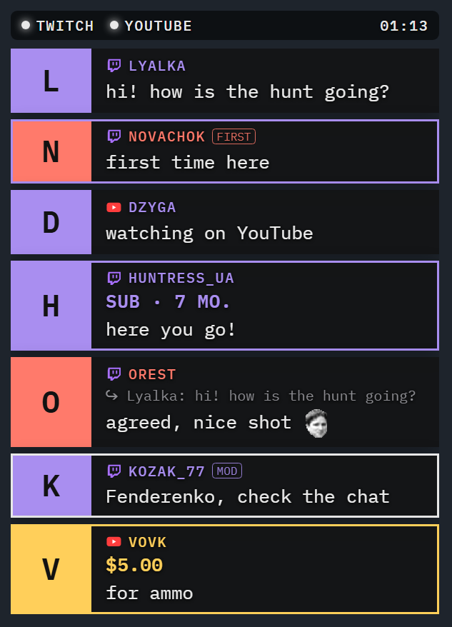

# Foldback Chat

[English](README.md)

Чат Twitch і / або YouTube в одному прозорому оверлеї для Windows: кожна платформа окремо або обидві в одному списку.
Його можна вживати двома способами або обома одразу:
- **поверх гри** — вікно, яке бачиш лише ти: OBS захоплює саму гру, сторонні вікна в стрім не потрапляють (гра має
  бути у вікні без рамок, не в повноекранному режимі);
- **в OBS** — той самий чат як джерело «Браузер», його бачать глядачі.



## Завантажити
[Релізи](https://github.com/Fenderenko/FoldbackChat/releases/latest): `FoldbackChat-<версія>.zip` (програма, ліцензія,
опис) або окремо `FoldbackChat-<версія>.exe`. Установника немає: просто запусти exe. Windows 10 / 11 з Microsoft Edge
WebView2 Runtime (у Windows 11 він уже є).

## Запуск
`FoldbackChat.exe` — значок з'явиться в треї. Клік по значку — показати / сховати чат, правий клік — меню.
Під час першого запуску налаштування відкриваються на сторінці «Канали». Підказка значка в треї показує стан кожного
каналу.

## В OBS
Джерела → + → Браузер, адреса `http://127.0.0.1:8792/obs` (у налаштуваннях, сторінка OBS, є кнопка «Копіювати»),
ширина й висота — будь-які, наприклад 420 × 620. Джерело бере твої канали й вигляд, зміни налаштувань підхоплює одразу,
тестові повідомлення з налаштувань з'являються і в ньому. Звуків у джерелі немає, програма має бути відкрита.

**Док і обране повідомлення.** Docks → Custom Browser Docks, адреса `http://127.0.0.1:8792/dock`: уся історія чату
просто у вікні OBS. Клац по повідомленню — і воно з'являється на стрімі в окремому джерелі «Браузер»
`http://127.0.0.1:8792/obs?featured` (картка, як у чаті, лише більша); ще один клац або задані секунди — і воно зникає.

## Для інших програм
Усі повідомлення й події (підписки, рейди, біти, суперчати, видалення, стан каналів) як JSON через WebSocket
`ws://127.0.0.1:8792/api/ws` або SSE `http://127.0.0.1:8792/api/events`, останні 100 повідомлень і команди, щоб вивести
повідомлення на екран, — для Streamer.bot, Stream Deck чи своїх скриптів. Опис англійською — [docs/API.md](docs/API.md).

## Клавіші (міняються в налаштуваннях)
- **Alt+Shift+C** — показати / сховати чат
- **Alt+Shift+X** — закріпити / відкріпити. Відкріплений чат можна тягнути, міняти розмір за краї й гортати історію
  коліщатком; закріплений пропускає клацання в гру.
- **Alt+Shift+S** — відкрити / закрити налаштування

## Що вміє
- Twitch (як гість, без пароля) і YouTube (без ключів; ефір шукається сам)
- емоути Twitch, 7TV, BTTV, FFZ і емодзі YouTube
- підсвічування згадок, своїх слів, новачків, модераторів, підписок, рейдів, бітів, суперчатів, повідомлень за бали каналу
- відповіді (кому й на що), свої кольори й позначки для глядачів
- звуки на кожен тип події: вбудовані або свій файл, гучність, пауза між звуками
- вигляд: картки або рядки, шрифти (будь-який шрифт Windows), розмір тексту, прозорість, кольори, кількість і
  зникання повідомлень; увесь чат може ховатися, коли тихо, і з'являтися з новим повідомленням
- палітри кольорів ніків: готові, свої, згенеровані
- фільтри: боти, команди, посилання, ігнор
- верхній рядок: стан каналів (зокрема «канал не знайдено»), глядачі, скільки йде стрім, годинник — розмір, колір і
  підкладка налаштовуються
- окреме місце чату для кожної гри на весь екран, вибір монітора; режим «Разом з OBS» — чат видно, поки працює OBS
- мови: англійська, українська, німецька, французька, іспанська, португальська, польська, італійська, турецька
- передає YouTube-чат у браузерні джерела OBS (SSE `http://127.0.0.1:8792/events`), поки програма відкрита

Налаштування, свої звуки, положення вікна, клавіші й місця для ігор зберігаються в `%APPDATA%\Foldback Chat`;
у `%LOCALAPPDATA%\Foldback Chat` — профіль WebView2.

## Збірка
Rust (MSVC); сама програма — `src/` (Rust) і `web/` (сторінки чату й налаштувань, HTML / CSS / JavaScript).
```
cargo build --release
copy target\release\FoldbackChat.exe FoldbackChat.exe
```
Python потрібен лише для службових скриптів у `tools/`: `mkicon.py` малює іконки (`assets/`), `i18n_src.py` зберігає
переклади й генерує `web/i18n.js`, `check_i18n.py` їх перевіряє. Їхні результати лежать у репозиторії, тож для збирання
Python не потрібен.

## Підтримати
Foldback Chat безкоштовний. Якщо він тобі знадобився, можна підтримати розробку: [банка monobank](https://send.monobank.ua/jar/6VR4c6nxzz).

## Ліцензія
GPL-3.0 — див. [LICENSE](LICENSE).
